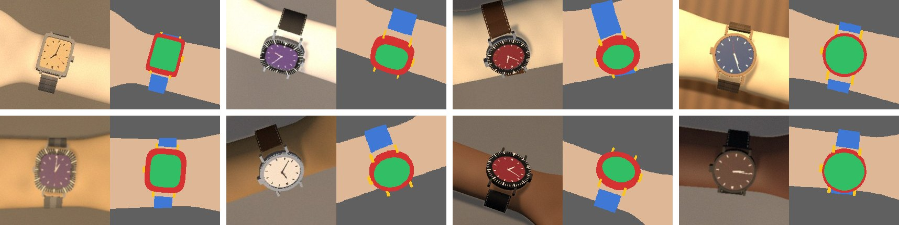

# Synthetic data

The models in Phase 2 have to find a watch's case and dial in a photo, precisely enough to measure from. Real photos are few, slow to label and limited to the wrists and watches photographed. Rendered photos are the opposite: unlimited, labelled exactly for free, and spread evenly over skin tones, poses and lighting. They also look rendered. So they are used to **train**, never to **evaluate**: every reported number comes from real photos ([PLAN §6](../PLAN.md#6-data-evaluation-and-privacy)). The code is in [`ml/`](../../ml/README.md), and the [data card](../cards/synthetic-v0-data-card.md) describes the generated set.

## The scene

Everything is measured in millimetres.

- **The surface** is the plane z = 0: a grey card like the capture backdrop, a desk or fabric.
- **The forearm** lies along the x axis with the hand towards +x. Its cross-section is an ellipse resting on the surface, half as wide as the wrist and half as high as it is thick, widening slowly towards the elbow. Past the wrist it narrows smoothly into the hand. It is an **implicit surface**: a function that is negative inside and positive outside. That makes the wrist-to-hand join seamless, with no mesh to build.
- **The watch** comes from a [stand-in specification](catalogue-and-stand-ins.md), sampled with every dimension known. It sits on top of the wrist, rolled a few degrees around the arm and turned a few degrees on it, with the crown towards the hand four times in five. Its 12-to-6 axis runs across the wrist, as on a real wrist, so lug-to-lug spans the top of the wrist.
- **The strap** is a shell around the forearm, as wide as the lugs. Under the watch there is none; at the lug tips it is lifted to where the lugs hold it and then ramps down onto the wrist.
- **The camera** is the Pixel 9a's main camera (4.53 mm on 1.6 µm pixels: about 2831 px of focal length at full size), 25 to 40 cm above the watch and tilted 0° to 45° around the arm's long axis, like the capture rig's T00, T20 and T40 blocks but continuous.

## Rendering: one ray per pixel

For each pixel, a ray leaves the camera, and the renderer finds the first thing it meets.

1. **The surface:** a plane, solved directly.
2. **The forearm and strap:** a ray first checks whether it passes through a cylinder around the arm at all (a 2-D circle test), which skips most of the image. Inside that cylinder it steps 1 mm at a time until the surface function turns negative, then bisects twelve times to find the crossing to a few micrometres.
3. **The watch:** in the watch's own frame, every part is a flat shape extruded between two heights: the case, the bezel ring, the dial at the bottom of its opening, four lugs, the crown. The case outline is a superellipse, so one formula covers round, cushion, tonneau and square cases. Each part is sliced every 0.35 mm, top to bottom, and the first slice a ray lands inside is where it hits. The top slice is the part's face; a lower one is its side wall, which is how the case's side appears when the camera is tilted.

The nearest of the three hits wins, as in a depth buffer.

**Shading** happens in linear light, then converts to sRGB:

- a key light from 30° to 80° above the horizon, coloured for daylight, warm lamps or a mix, plus a fill light from the sky;
- matte surfaces scatter light (Lambert) with a soft highlight;
- metals mirror a simple room, bright above and dark below, which is what makes steel look like steel;
- the crystal adds a faint reflection and a sharp glint.

Shadows come from tracing from each point towards the key light: the arm shadows the surface, and the watch shadows the wrist. Then come the camera's own effects: auto-exposure on the surface, vignetting, a little blur, sensor noise, and JPEG compression at quality 82 to 95.

**Dials have no text or logos:** generic hour markers, three hands at a random time, and on rotating bezels a generic minute scale with a triangle at 12.

## Labels are computed, not drawn

| Label | How it is computed |
|---|---|
| Class mask | The kind of surface each pixel's ray hit first: background, skin, strap, lugs and crown, case and bezel, dial |
| Outlines | The 3-D edges of the case top and back, the bezel and the dial opening, projected through the camera: 180 points each |
| Reference circle | For a round case: the case top's circle in 3-D (centre, normal, radius), with the ellipse it makes in the image |
| Scale | Pixels per millimetre at the case top, from the focal length and the depth |
| Poses | The camera's rotation and position, and the watch's frame |
| Wrist | Width, thickness and circumference of the modelled wrist, and where its silhouette crosses the line through the watch |

How exact is "exact"? The outlines and numbers come straight from the geometry. The mask depends on the step sizes. With the 1 mm step, a 1024-pixel render differs from a 0.25 mm reference in about 60 of its 786,432 pixels, all on the strap's edges. The watch's 0.35 mm slices move a tilted wall's edge by less than a pixel. The tests check that the masks and outlines agree: straight down, a round case's image is a circle whose radius matches the labelled scale to within 3%, and tilted by 30° it is squeezed by the cosine.

## Reproducible by construction

Sample *i* of a run comes from a random generator seeded with `[seed, i]`. Any sample can be rebuilt alone, a run can be extended without changing what it already made, and an interrupted run is finished by running the same command again: samples already on disk are skipped, and the manifest is rebuilt from the label files.

## What it can't teach

The [data card](../cards/synthetic-v0-data-card.md) lists the limitations in full. In short, the hands have no fingers, the skin has no hair, veins or creases, the lighting has no bounce, and dials carry no text. That gap between rendered and real (the *domain gap*) is why these images only ever train. In Phase 2 it is measured directly: a model trained on synthetic data alone, then on synthetic plus real training photos, both scored on the real dev split.

## Where it lives

| What | Where |
|---|---|
| Scene and sampling | `ml/src/lugtolug_ml/synthetic/scene.py` |
| Rendering | `ml/src/lugtolug_ml/synthetic/render.py` |
| Label format | `ml/src/lugtolug_ml/synthetic/labels.py` |
| Generator | `ml/src/lugtolug_ml/synthetic/generate.py` (`uv run poe synth`) |
| Camera model and ellipse fit | `packages/core/src/lugtolug_core/geometry.py` |
| Generated data | The work folder next to the repository (`work/synthetic/v0`), never committed |
